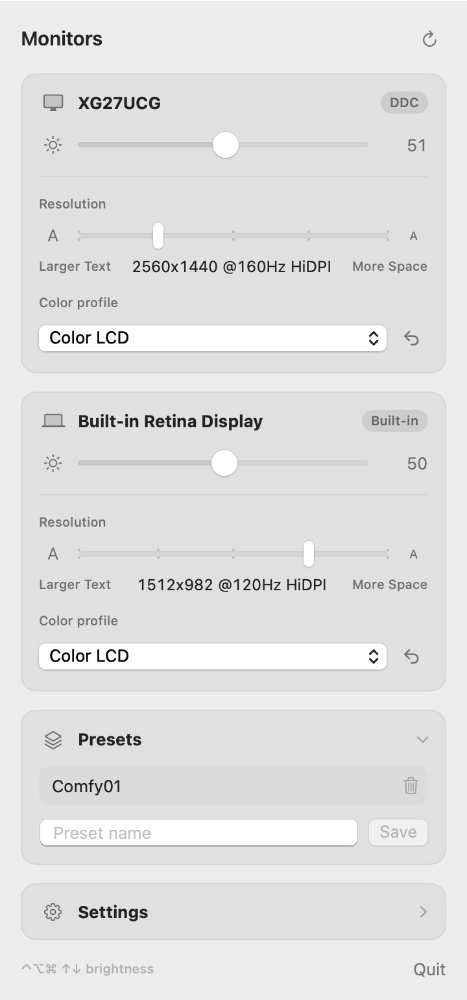
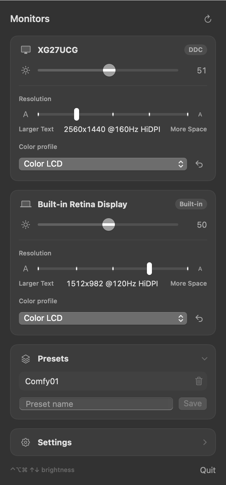

# Mony

Atur **brightness, contrast, resolusi, dan color profile** monitor eksternal dari Mac Apple Silicon, apa pun merk monitornya. Gratis.

<p>
  
  
</p>

## Unduh

Unduh versi terbaru yang stabil dari [Releases](../../releases/latest):

| File | Isi |
|---|---|
| `Mony-<versi>-MonyBar.app.zip` | App menu bar dengan slider, resolusi rekomendasi, preset, dan hotkey |
| `Mony-<versi>-monyctl.zip` | CLI untuk skrip dan shortcut |

Branch `stable` adalah versi yang direkomendasikan. Branch `latest` memuat catatan rilis terbaru yang mungkin belum diuji penuh.

## Persyaratan

macOS 13+ pada Apple Silicon. Monitor harus mengaktifkan DDC/CI di menu OSD agar brightness hardware bisa dikontrol.

## Pemasangan

1. Unzip, lalu pindahkan `MonyBar.app` ke `/Applications`.
2. Build ini belum di-notarize. Saat pertama dibuka, klik kanan `MonyBar.app` → **Open** → **Open**. Atau jalankan:
   ```sh
   xattr -cr /Applications/MonyBar.app
   ```
3. Untuk CLI: `xattr -cr monyctl && chmod +x monyctl && mv monyctl /usr/local/bin/`.

## Fitur

- Brightness dan contrast monitor eksternal lewat DDC/CI; layar bawaan lewat DisplayServices.
- Fallback software dimming (gamma) untuk monitor yang tidak mendukung DDC.
- Resolusi: default 5 pilihan rekomendasi ("Larger Text" sampai "More Space"); mode advanced menampilkan semua mode.
- Color profile ICC per display, dengan tombol reset ke profil bawaan.
- Preset: simpan dan terapkan kombinasi brightness, contrast, resolusi, dan color profile.
- Sinkron brightness ke semua monitor dan hotkey global ⌃⌥⌘ ↑/↓.

## Lisensi

Freeware. Gratis dipakai dan dibagikan tanpa modifikasi; source code tidak dirilis. Lihat [LICENSE](LICENSE).

## Masalah

Laporkan lewat [Issues](../../issues). Set `MONY_DEBUG=1` untuk log DDC mentah ke stderr dan lampirkan di laporan.
